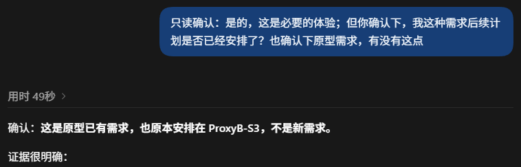

# 理解 AI、质疑 AI 实例

**核心：用具体反例追到需求校对问题，再逐层问清方案的解法、边界和验证范围。**

两段移动方案对话截图记录了追问过程；其中的方案说明、需求归属和验证数字仍需回原项目核实。

相关方法：[理解 AI 方案的提示词](../理解与评审/理解AI方案的提示词.md)、[评审 AI 方案的做法](../理解与评审/评审AI方案的做法.md)、[项目规范治理做法](项目规范治理做法.md)。

## 从侧向挤出反例追到需求校对

从两种移动情况的示意图，追问侧向挤出、原型需求及校对时点。

这段对话把问题定位为设计阶段的需求校对遗漏；是否确属遗漏，仍需以原项目的需求和规范为准。

### 发现流程问题后暂停并修正

接着追问校对为何遗漏、最小修正应落在哪里，再要求先更新规范和相关方案，留出人工确认点。

## 逐层理解 PSCC 方案

依次追问旧 PGS4 的处理位置、PSCC 的替换范围、成员处理顺序、`cap`、规模限制及 `support` 边界。

到此，对话将初始 `cap` 中的静态障碍物限制与联合收紧时的成员碰撞、连接约束区分开来。后续继续追问尺度和未覆盖的能力。

这段对话形成的阶段性理解是：截图所述 PSCC 只替换特定的压力传递处理，`support` 换边留待后续设计；截图提到的性能、规模和验证状态仍需回原项目证据核对。
